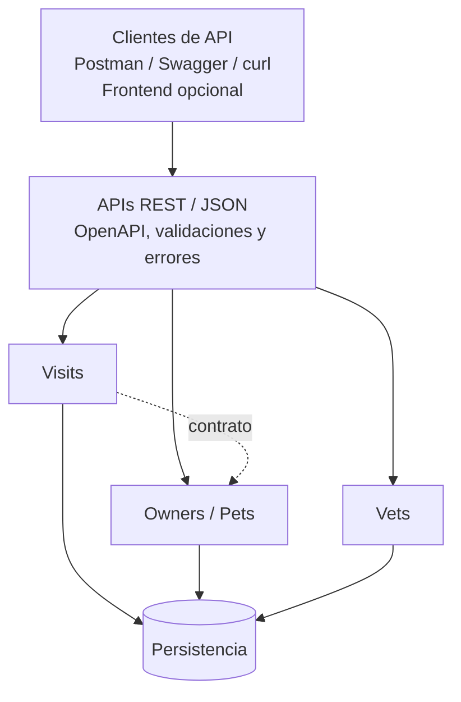

# Documentación de Arquitectura

## 1. Visión General de la Solución

Para la modernización del backend de **Spring PetClinic**, se seleccionó una arquitectura basada en **Arquitectura Hexagonal (Puertos y Adaptadores)** estructurada como un **Monolito Modular**.

Esta decisión permite desacoplar de forma estricta las reglas de negocio de los detalles técnicos (Spring MVC, JPA, base de datos relacional), manteniendo la simplicidad operativa de un único artefacto desplegable sin incurrir en la sobrecarga ni complejidad de red de una red distribuida de microservicios.

---

## 2. Diagrama de Arquitectura Lógica

El siguiente diagrama representa las responsabilidades lógicas del sistema y el flujo de comunicación desde los clientes hacia los módulos de negocio y la persistencia:



*Nota: La persistencia relacional compartida representa la simplificación adecuada para un monolito modular en transición. Cada módulo interactúa únicamente a través de su propio adaptador de persistencia y sus contratos bien definidos.*

---

## 3. Estructura Interna: Puertos y Adaptadores

Cada contexto de negocio está organizado internamente aplicando los principios de la Arquitectura Hexagonal:

```
+---------------------------------------------------------------------------------+
|                              ADAPTADORES DE ENTRADA                             |
|  - Controladores REST (/api/v1/vets, /api/v1/owners, etc.)                      |
|  - Request y Response DTOs con Jakarta Bean Validation                          |
|  - Documentación de contrato Swagger / OpenAPI 3.0                              |
+---------------------------------------------------------------------------------+
                                       |
                                       v  (Llama al Puerto de Entrada)
+---------------------------------------------------------------------------------+
|                                APLICACIÓN Y DOMINIO                             |
|  +---------------------------+             +----------------------------------+ |
|  |    PUERTOS DE ENTRADA     |             |        PUERTOS DE SALIDA         | |
|  |     (Casos de Uso)        |             |      (Interfaces Repository)     | |
|  +---------------------------+             +----------------------------------+ |
|               ^                                             ^                   |
|               | implementa                                  | consume           |
|  +----------------------------------------------------------+                 | |
|  |                    SERVICIOS Y REGLAS DE NEGOCIO                           | |
|  |  - Validaciones de fechas futuras, mapeos y lógica de aplicación           | |
|  +----------------------------------------------------------------------------+ |
|  |                          MODELOS DE DOMINIO                                | |
|  |  - Modelos Java puros: VetModel, OwnerModel, PetModel, VisitModel          | |
|  +----------------------------------------------------------------------------+ |
+---------------------------------------------------------------------------------+
                                       ^
                                       | implementa Puerto de Salida
+---------------------------------------------------------------------------------+
|                              ADAPTADORES DE SALIDA                              |
|  - Adaptadores de persistencia (VetPersistenceAdapter, etc.)                    |
|  - Repositorios Spring Data JPA y mapeos relacionales a BD                      |
+---------------------------------------------------------------------------------+
```

### Componentes de la Arquitectura:

1. **Modelos de Dominio (`domain`)**:
   Clases POJO independientes de cualquier anotación de base de datos (`@Entity`, `@Table`) o de controladores web. Contienen los atributos esenciales de negocio.
2. **Puertos de Entrada (`port.in`)**:
   Interfaces Java que declaran los casos de uso disponibles para el sistema (por ejemplo, `OwnerUseCase`, `PetUseCase`, `VisitUseCase`, `GetVetsUseCase`).
3. **Servicios de Aplicación (`service`)**:
   Implementan los puertos de entrada. Aplican las reglas de negocio, validaciones semánticas y orquestan las operaciones con los puertos de salida.
4. **Puertos de Salida (`port.out`)**:
   Interfaces que definen las necesidades de datos del dominio (por ejemplo, `OwnerRepositoryPort`, `PetRepositoryPort`, `VisitRepositoryPort`, `VetRepositoryPort`).
5. **Adaptadores de Entrada (`adapter.in.web`)**:
   Controladores REST de Spring MVC que exponen rutas HTTP bajo `/api/v1/*`. Reciben DTOs validados con `@Valid` y devuelven DTOs de respuesta.
6. **Adaptadores de Salida (`adapter.out.persistence`)**:
   Clases componentes de Spring que implementan los puertos de salida y encapsulan el uso de los repositorios JPA existentes.

---

## 4. Definición de Límites Modulares

El sistema se dividió en cuatro contextos bien delimitados dentro de `org.springframework.samples.petclinic`:

### 4.1. Módulo `customer` (Owners y Pets)
- **Responsabilidad**: Gestión integral de los clientes de la veterinaria y sus animales de compañía.
- **Entidades de dominio**: `OwnerModel`, `PetModel`, `PetTypeModel`.
- **Justificación del límite**: En el modelo de negocio veterinario, una mascota no existe sin un propietario responsable. Agruparlos bajo el mismo módulo respeta la agregación natural y simplifica las transacciones de alta y consulta.

### 4.2. Módulo `visit` (Citas y Consultas)
- **Responsabilidad**: Agendamiento y consulta del historial médico de las mascotas.
- **Entidades de dominio**: `VisitModel`.
- **Relación por Contrato**: Se comunica con el módulo de `customer` mediante identificadores (`ownerId`, `petId`), verificando la existencia de las entidades antes de agendar.
- **Regla de negocio principal**: Las citas deben agendarse obligatoriamente en fechas futuras respecto al día actual.

### 4.3. Módulo `vet` (Veterinarios y Especialidades)
- **Responsabilidad**: Catálogo de profesionales médicos y sus especialidades.
- **Entidades de dominio**: `VetModel`, `SpecialtyModel`.
- **Independencia**: Es un módulo de solo lectura para los clientes, sin dependencias funcionales hacia los dueños ni las visitas.

### 4.4. Módulo `common` (Aspectos Transversales)
- **`OpenApiConfig`**: Configuración centralizada de metadatos OpenAPI 3.0 para la generación automática de Swagger UI.
- **`GlobalExceptionHandler`**: Manejador global con `@RestControllerAdvice` que estandariza los errores de validación (`MethodArgumentNotValidException`), recursos no encontrados (`ResponseStatusException`, `IllegalArgumentException`) y errores internos bajo la especificación **RFC 7807 (`ProblemDetail`)**.

---

## 5. Justificación de la Elección Arquitectónica

Se evaluaron dos opciones principales:

| Criterio | Opción A: Microservicios Distribuidos | Opción B: Monolito Modular Hexagonal (Elegida) |
| :--- | :--- | :--- |
| **Complejidad de Red** | Alta (múltiples puertos, llamadas HTTP/gRPC) | Nula (llamadas en memoria dentro de la JVM) |
| **Transaccionalidad** | Requiere patrones complejos (Saga, 2PC) | Atómica y segura con transacciones locales |
| **Despliegue y Pruebas** | Requiere orquestadores o múltiples contenedores | Sencillo (un solo comando `./mvnw test` o `./mvnw spring-boot:run`) |
| **Desacoplamiento** | Alto, a costa de latencia y sobrecarga | Alto, garantizado por paquetes, puertos e interfaces |
| **Camino de Evolución** | Ya distribuido | Si el tráfico lo exige, los módulos se pueden extraer a microservicios fácilmente |

**Conclusión**: La Opción B cumple con creces el objetivo de modernización, proporciona una separación de responsabilidades clara y verificable, y elimina riesgos operativos innecesarios para el tiempo y alcance de la prueba técnica.
